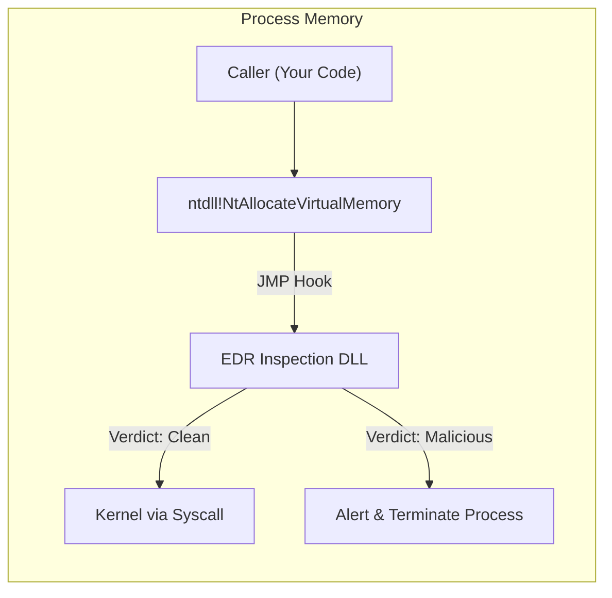

## Introduction

Modern Endpoint Detection and Response (EDR) solutions primarily rely on user-mode hooks to monitor API calls made by untrusted processes. When a process invokes a sensitive native API (such as `NtAllocateVirtualMemory` or `NtCreateThreadEx`), the call is intercepted before reaching the Windows kernel.

In this writeup, we will dissect how user-mode inline hooks function, how detection occurs, and how security researchers utilize direct and indirect system calls (syscalls) to bypass userland inspection.

---

## The Mechanics of User-Mode Hooking

When an EDR sensor injects its DLL into a target process, it modifies the prologue of critical exported functions inside `ntdll.dll`.

Typically, a clean native API stub resembles the following in x64 assembly:

```nasm
mov r10, rcx
mov eax, <SSN>          ; System Service Number (SSN)
test byte ptr [7FFE0308h], 1
jne 0x7FFE0300
syscall
ret
```

An EDR replaces the initial bytes with an unconditional jump (`jmp` or `mov rax, addr; jmp rax`) pointing to the EDR's inspection hook:

```nasm
jmp <EDR_Sensor_Hook_Address>
nop
nop
```



---

## Bypassing User-Mode Hooks

There are several established approaches to circumvent user-mode telemetry:

1. **Direct Syscalls:** Extracting the SSN dynamically and executing the `syscall` instruction directly from the attacker's executable memory.
2. **Indirect Syscalls:** Resolving the SSN, then jumping to a `syscall; ret` gadget residing within clean `ntdll.dll` memory to maintain legitimate return addresses.
3. **DLL Unhooking (Perun's Fart):** Reading a clean copy of `ntdll.dll` from disk or a suspended process and overwriting the hooked `.text` section in memory.

### Code Example: Reading Native SSN Dynamically

Below is a conceptual C++ implementation demonstrating how to verify if a function stub in `ntdll` is hooked:

```cpp
#include <windows.h>
#include <iostream>

bool IsFunctionHooked(FARPROC pFuncAddress) {
    BYTE* pByte = reinterpret_cast<BYTE*>(pFuncAddress);

    // Standard x64 stub begins with: 4C 8B D1 B8 (mov r10, rcx; mov eax, SSN)
    if (pByte[0] == 0xE9 || (pByte[0] == 0x48 && pByte[1] == 0xB8)) {
        // 0xE9 is a near JMP (common hooking instruction)
        return true;
    }

    return false;
}

int main() {
    HMODULE hNtdll = GetModuleHandleA("ntdll.dll");
    if (!hNtdll) return 1;

    FARPROC pNtAlloc = GetProcAddress(hNtdll, "NtAllocateVirtualMemory");

    if (IsFunctionHooked(pNtAlloc)) {
        std::cout << "[!] NtAllocateVirtualMemory is HOOKED by userland telemetry!\n";
    } else {
        std::cout << "[+] NtAllocateVirtualMemory appears clean.\n";
    }

    return 0;
}
```

> [!TIP]
> Always verify call stack traces. Even when using direct syscalls, advanced sensors examine the thread's call stack to ensure the call originated from within the expected caller boundary.

---

## Conclusion

Understanding user-mode hooking is essential for both offensive tradecraft and defensive architecture. In upcoming posts, we will explore **Call Stack Spoofing** and **Synthetic Frames** to evade modern heuristic stack-walking detectors.

Stay tuned!
