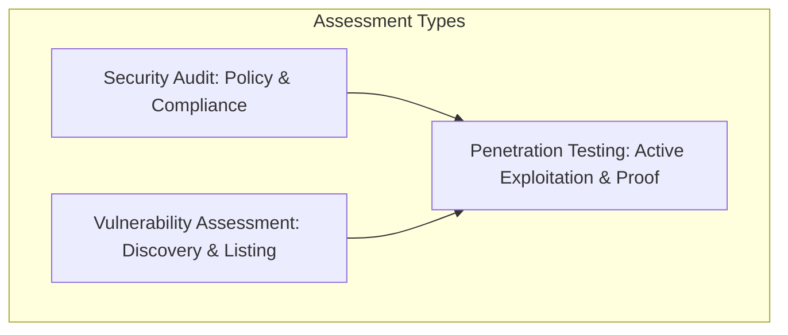
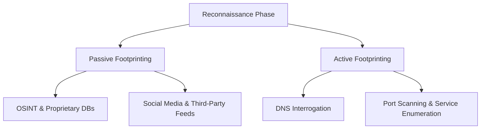
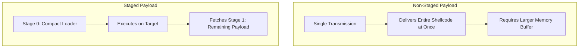
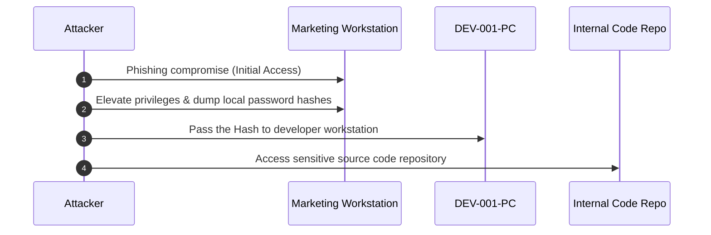

**Note: These are my personal notes on parts of the book, not a full summary of it.**

"Traditional vs Generative AI Pentesting: A Hands-On Approach to Hacking" by Yassine Maleh explores the intersection of classic offensive security methodologies and modern generative AI capabilities. The book is aimed at beginners and aspiring penetration testers looking to understand core assessment phases and how artificial intelligence can assist daily security workflows.


---

## Foundations of Penetration Testing

A solid penetration testing engagement relies on formal definitions, clear boundaries, and established frameworks before any technical actions are taken.

- **Security Audit:** A systematic process analyzing and assessing whether an IT system adheres to defined security policies, procedures, and recognized standards (such as ISO 27001). It provides an overall assessment of policies and controls but does not evaluate specific exploitable technical flaws.
- **Vulnerability Assessment:** Focuses on discovering vulnerabilities within an information system, but provides no indication of whether these weaknesses can be exploited or the extent of damage that could result.
- **Penetration Testing:** A methodological approach encompassing security auditing and vulnerability assessment that actively demonstrates whether identified vulnerabilities can be successfully exploited.
- **Ethical Hacking:** The practice where professionals are hired to simulate real-world attacks against systems, networks, and applications to uncover weaknesses before malicious actors can exploit them.

### Penetration Testing Strategies
- **Black Box:** The tester operates with no prior knowledge of the target environment.
- **White Box:** The tester is provided extensive internal information regarding the infrastructure under evaluation.
- **Gray Box:** A hybrid approach combining aspects of both white-box and black-box testing.

### Penetration Testing Process
1. Strategic planning and reconnaissance
2. Vulnerability scanning
3. Exploitation and post-exploitation
4. Reporting
5. Cleanup and follow-up

### Governance and Restrictions
- **Rules of Engagement (RoE) & Non-Disclosure Agreement (NDA):** Essential governing documents protecting both client and tester.
- **Scope Verification:** The team must clearly delineate what is in scope and what is excluded. Legal boundaries must be strictly observed; testers cannot assess adjacent subnets or unapproved targets without formal written consent.
- **Operational Constraints:** Constraints must define acceptable conduct for physical and social engineering assessments, minimize intrusiveness on fragile legacy systems, handle potential denial-of-service risks, and observe regulatory tool mandates where specific toolsets are required.



### Established Methodologies
- OSSTMM (Open Source Security Testing Methodology Manual)
- PTES (Penetration Testing Execution Standard)
- NIST SP 800-115
- ISSAF
- OWASP
- Cyber Kill Chain
- MITRE ATT&CK

### AI-Driven Penetration Testing Overview
- **Key Features:** Automation of repetitive tasks, advanced threat detection, predictive analytics, real-time analysis, and enhanced reporting insights.
- **Dedicated Tools:** HackerGPT, BurpGPT, PentestGPT, BugBountyGPT, CybGPT, and DeepExploit.

---

## Chapter 3 - GenAI-Driven Reconnaissance for Effective Penetration Testing

Reconnaissance forms the basis of all subsequent testing phases. It is divided into passive and active gathering techniques:

- **Passive Footprinting:** Gathering intelligence without direct host engagement via OSINT, proprietary databases, third-party intelligence feeds, and social media platforms.
- **Active Footprinting:** Direct interaction with target assets through DNS interrogation, social engineering, network and port scanning, and user and service enumeration.
- **Reconnaissance Tooling:** Classic tools discussed include Sublist3r, Subbrute, and Nmap.



### Applying GenAI to Reconnaissance
- Provide the model with your exact defined scope and target parameters.
- Structure prompts around specific phases and clarify the precise outputs required.
- Translate your manual methodology into instructions: specify the tools you would have executed manually and the steps the AI should follow.
- Utilize CLI-driven utilities such as `sgpt` (or free alternatives like OpenCode) paired with well-written skills. A precise prompt and a strong model directly produce high-quality recon intelligence.

---

## Chapter 4 - GenAI-Enhanced Scanning and Sniffing

Scanning moves from broad discovery into detailed port, protocol, and service mapping.

- **Nmap Usage:** Network Mapper command-line syntax `nmap [options] target`.
  - AI prompt example using `sgpt`:
    ```bash
    sgpt --chat scan --shell "use nmap to find full open ports on target and identify the os and make sure to identify TCP and UDP ports and display the results"
    ```
- **Hping3:** Versatile tool for network scanning and custom packet crafting across TCP, UDP, ICMP, and raw-IP protocols:
  - Command structure: `hping3 <options> <Target IP address>`
  - AI prompt example:
    ```bash
    sgpt --chat scan --shell "Run an hping3 ACK scan on port 80 of target IP 10.10.1.11"
    ```

### Sniffing Concepts and Vulnerable Protocols
- **Passive Sniffing:** Captures and monitors traffic circulating in a common collision domain without packet injection.
- **Active Sniffing:** Injects traffic into switched networks to intercept data. Active techniques include MAC Flooding, DNS Poisoning, ARP Poisoning, DHCP Attacks, Switch Port Stealing, and Spoofing Attacks.
- **Protocols Vulnerable to Sniffing:** Telnet, Rlogin, HTTP, SNMP, SMTP, POP, FTP, and IMAP. Wireshark is the standard tool utilized for packet analysis.

---

## Chapter 5 - Vulnerability Assessment

A vulnerability represents a weakness in an operating system, network, or application that can lead to compromise when targeted by a threat.

- **Vulnerability Classifications:** Misconfigurations and weak configurations, application flaws, poor patch management, design flaws, and third-party risks.
- **Characteristics of Effective Assessment Solutions:** Verifies live assets accurately; employs structured, inference-based testing; checks updated databases automatically; outputs adaptable, risk-prioritized reports; supports diverse network topologies; and offers actionable remediation recommendations.
- **Scoring Systems and Databases:** CVSS, CVE, NVD, and CWE.
- **Scanner Categories:**
  - *General Purpose:* Nessus, Nexpose, Qualys.
  - *Web Application:* AppScan, Netsparker.
  - *Specific Application:* SSLScan, OneSixtyOne, WPScan.
- **Research Resources:** Microsoft Security Response Center (MSRC), Packet Storm, Dark Reading, Trend Micro, Security Magazine, PenTest Magazine, SC Magazine, Exploit-DB, Help Net Security, HackerStorm, Computerworld, and D'Crypt.
- **WAF Identification:** Checking the perimeter using tools such as `wafw00f`.

### GenAI Workflow in Vulnerability Assessment
- Example automated command generation:
  ```bash
  sgpt --chat scan --shell "Generate a WPScan command to detect vulnerabilities on a WordPress site at blog.example.com."
  ```
- Directing AI logically: prompt the assistant to conduct port discovery first; if a specific software version is identified, instruct it to search Exploit-DB via `searchsploit`, verify applicability, document initial findings, and proceed systematically through services.
- Modern models can formulate hypotheses and script small validation checks autonomously when given clear instructions.

### Vulnerability Report Structure
- Executive Summary
- Assessment Overview
- Findings
- Risk Assessment
- Recommendations
- Conclusion
- Follow-Up Actions and Timeline
- Glossary of Terms
- Classification covers technical security vulnerability reports and high-level summaries.

---

## Chapter 6 - AI-Driven Social Engineering and Penetration Testing

Social engineering manipulates individuals into divulging confidential information or executing unauthorized actions.

- **Human-Based Vectors:** Impersonation, Vishing (Voice Phishing), USB Drop attacks, Watering Hole attacks, Tailgating, Dumpster Diving, Shoulder Surfing, and Badge Cloning.
- **Computer-Based Vectors:** Instant messaging attacks, spam, scareware, phishing, spear phishing, and whaling.
- **Tooling:** Social-Engineer Toolkit (SET), SocialPhish (e.g., credential-harvesting templates), and GoPhish. Phishing detection utilizes services such as Netcraft and PhishTank.
- **GenAI Phishing Crafting:** Drafting targeted pretext emails (e.g., internal IT administrator notices requiring mandatory software updates by a specific deadline).
- **Deepfake Technologies:** Tools referenced include Vidnoz, Deepfakesweb, Synthesia, DeepBrain AI, and Hoodem, alongside conversational models like ChatGPT and Claude for persona simulation.

---

## Chapter 7 - GenAI-Driven Exploitation Testing Techniques

Exploitation validates vulnerability impact by acquiring foothold access.

### Staged vs. Non-Staged Payloads
- **Non-Staged Payloads:** Transmit the entire exploit shellcode in a single package (e.g., `windows/meterpreter_reverse_tcp`). Requires more initial memory and larger bandwidth, which can fail in size-restricted buffers or constrained connections.
- **Staged Payloads:** Deliver an initial compact stub (loader) that connects back and fetches the remainder of the payload sequentially (e.g., `windows/meterpreter/reverse_tcp`). Minimizes the initial footprint to bypass buffer constraints, but introduces execution dependencies on uninterrupted network stability.



### Leveraging GenAI in Exploitation
- Provide the model with identified ports and vulnerable versions, directing it to locate matching exploit modules step-by-step toward shell acquisition.
- Command generation example:
  ```bash
  sgpt --shell "Use msfvenom to create a TCP payload with lhost=172.16.253.130 and lport=9990"
  ```

---

## Chapter 8 - Post-Exploitation Techniques and AI-Driven Privilege Escalation

Post-exploitation determines the real business risk and extent of compromise across an infrastructure.

- **Key Activities:** Analyzing the compromised host, leveraging system resources for pivoting, and proving impact.
- **File Transfer Mechanisms:** HTTP/HTTPS, FTP/TFTP, and SCP.

### Defensive Evasion Tactics
- **AV/EDR Detection Points:** Delivery via email, network file shares, USB media, download stages, and in-memory execution.
- **Bypassing Mechanisms:** Disabling security software (high administrative risk), payload encoding to modify signatures, in-memory execution without touching disk, and custom compilation options.
- **Operational Evasion Practices:** Using encrypted command-and-control channels and living off the land (using legitimate native administrative utilities).

### Pivoting and Lateral Movement
- **Pivoting:** Utilizing an initial compromised machine as a launchpad to reach internal networks isolated from the external perimeter via SSH Port Forwarding or Meterpreter network routes.
- **Lateral Movement:** Traversal across networked workstations and servers while minimizing monitoring alerts.
- **Credential Acquisition Methods:** Pass the Hash, Pass the Ticket (Kerberos Golden Tickets), memory scraping via Mimikatz, and keyloggers.



---

## GenAI for Automating and Enhancing Penetration Testing Reports

The book concludes by discussing the use of generative models to streamline reporting components:
- Structuring technical summaries and risk rankings
- Aggregating general findings across reconnaissance, scanning, and exploitation
- Generating strategic remediation roadmaps
- Standardizing tool listings and post-operational documentation

---

## My Overall Opinion

I finished this book, and honestly, it is good, not bad at all. For someone new to the field, it is a solid read, especially because it gives you a general foundation and a glimpse of everything. 

Some topics are slightly more advanced and are not covered in depth, such as persistence, lateral movement, pivoting, and the different techniques for each; the book only gives a brief overview of them. Many parts also lack hands-on practice. 

I think the author's mistake was explaining each technique twice, once manually and once using AI. Explaining the general method of using the model once would have made that repetition unnecessary, since the same approach is used each time. Instead, the prompts are overly specific and narrow, for example telling the AI to exploit the EternalBlue vulnerability on one particular machine. 

Still, it is a nice and enjoyable book. I learned things I did not know before, and I would recommend it to anyone new to the field as a read after "Penetration Testing: A Hands-On Introduction to Hacking". If applied well, the two together can bring you to eJPT level or higher, as they complement each other and cover each other's gaps.
